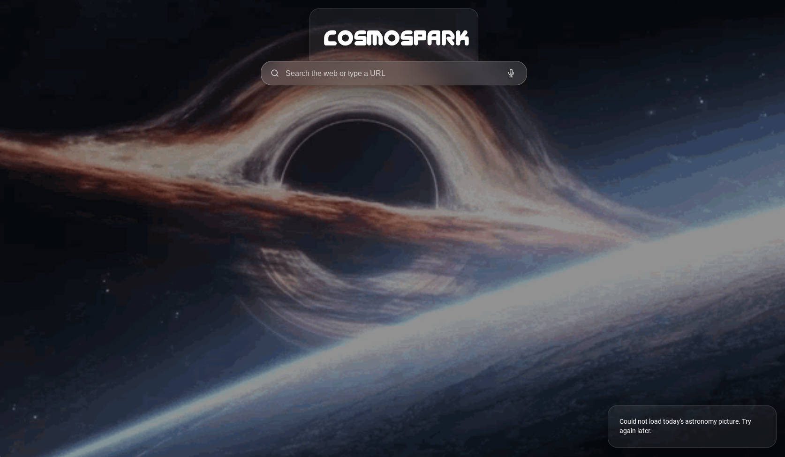

# Cosmospark
The safest web browser that uses a backend that doesn't collect IP addresses.

### Go ahead and try the website out by clicking the Try It button
### [<kbd> Try It!!! </kbd>](https://cosmospark.org/)
### Features
- Glassmorphism-based UI
- Scrapes DuckDuckGo using backend not your IP address
- Space-themed!
### How it works
It works using a backend that scrapes DuckDuckGo results, so that way, it doesn't use your computer browser so hackers can't see what YOU searched up. Nothing you search up saves in the backend, nor your computer search history, so it is basically incognito mode for search. 

